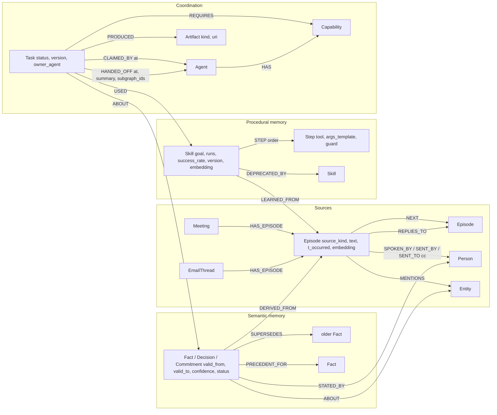

# Minutes

Shared, time-aware memory for agent teams, built on FalkorDB. Minutes turns what a team said in meetings and wrote in email into a graph that a team of agents reads, writes and hands work through. Every answer comes back with the path that produced it: who said it, in which meeting or email, at what time, and what it replaced.

Built for Graph Hacks: Context for AI Agents (WeMakeDevs x FalkorDB, Oct 15 to 18, 2026). Tracks entered: 2 (Agent Memory and Coordination) and 3 (Company Brain).

> Status: under construction. Sections marked TODO are filled in as the build lands.

## Team Vulcan

| Member | GitHub |
|---|---|
| Pallab Das | [@PDGamerSG](https://github.com/PDGamerSG) |
| Yuvraj Singh | [@Yuvraj-025](https://github.com/Yuvraj-025) |
| Rudra Pratap | [@rpratap2111](https://github.com/rpratap2111) |
| Aditya Arnav | [@Hydra-Of-Malice](https://github.com/Hydra-Of-Malice) |

## What it does

- **Episodic memory**: every utterance and every email becomes an `Episode` with a speaker or sender, a timestamp and an embedding, chained in order.
- **Semantic memory**: facts, decisions and commitments are extracted by Gemma 4, validated, and stored bi-temporally (`valid_from`, `valid_to`). When a date moves or a vendor changes, the old fact is expired and linked with `SUPERSEDES`, even when the change came from a different source (a meeting commitment moved by an email).
- **Procedural memory**: recurring routines (the standup) are learned as `Skill` nodes with ordered `Step`s and a success rate that updates every time an agent runs them.
- **Coordination**: agents claim tasks with a compare-and-set Cypher query, hand off through `HANDED_OFF` edges that carry subgraph ids, and wake each other over Redis pub/sub on the same server. Task states follow A2A (submitted, working, input_required, completed, failed).
- **Tenancy**: one FalkorDB graph per team plus a shared `commons` graph, enforced with per-graph ACL users. Remove FalkorDB and nothing works: memory, tasks, skills, tenancy and answers all live in the graph.
- **Explainability**: the Why panel shows the Cypher that ran, the subgraph it touched, the router decision, and a "play at timestamp" or "open email" link for every source.

## Repository

```
cypher/              every query the product depends on, numbered, single source of truth
packages/hiveboard/  the substrate: schema, tenancy, memory, board, skills, events, UDF, MCP server, bench
packages/ingest/     recorder and email formats, chunking, EmbeddingGemma, Gemma 4 extraction, eval
apps/api/            FastAPI: routes, agents (fact, follow-up, scheduler, standup, answer), SSE
apps/web/            Next.js: sources, chat with Why panel, board, timeline, skills, bench
data/                scripted meetings and email threads (synthetic, our own), gold labels, seed
docs/                research, plan, contracts, demo script, benchmark results
```

## Run locally

```bash
cp .env.example .env
docker compose up -d falkordb          # FalkorDB 6.0.x on 6379, Browser on 3000
uv sync
uv run --package minutes-api python data/seed.py --tenants orbit,nimbus,quill --reset
uv run --package minutes-api uvicorn apps.api.main:app --port 8000
cd apps/web && pnpm install && pnpm dev -p 3001
```

Models: default `.env` uses Ollama with `gemma4:e4b` locally (`ollama pull gemma4:e4b`). For the Gemini API set `LLM_BACKEND=gemini` and `GEMINI_API_KEY`; for OpenRouter set `LLM_BACKEND=openrouter` and `OPENROUTER_API_KEY`. Embeddings: EmbeddingGemma 768-d via ONNX Runtime on CPU (`EMBED_BACKEND=onnx`), or `fake` for tests.

## Graph data model

One FalkorDB graph per team (`team_<slug>`) plus a shared `commons` graph (tenant registry, snapshot metadata, published skills). All timestamps are epoch milliseconds. Every node with an `id` has a unique constraint.



| Label | Key properties | Role |
|---|---|---|
| Person | id, name, role, email | speakers and email senders; the roster joins the two sources |
| Meeting, EmailThread | id, title or subject, started_at | episode containers |
| Episode | id, seq, source_kind (utterance, email), text, t_start, t_end, t_occurred, t_ingested, embedding | episodic memory, chained by NEXT |
| Entity | id, name, type, embedding | what episodes and facts are about; CO_MENTIONED edges feed WCC |
| Fact (+Decision, +Commitment label) | id, key (subject plus predicate), object, text, confidence, valid_from, valid_to, created_at, expired_at, status, due_at | semantic memory, bi-temporal; status active, superseded or retracted |
| Task | id, kind, status (submitted, working, input_required, completed, failed), version, owner_agent, priority, payload | blackboard; version is the compare-and-set token |
| Agent, Capability | id, name, model; name | who can claim what |
| Skill, Step, FailureMode | id, goal, runs, success_rate, version, status, embedding; order, tool, args_template, guard | procedural memory with outcome statistics |
| Artifact | id, kind (github_issue, nudge, standup_summary), uri, text, simulated | what agents produced |
| Snapshot, Tenant (in commons) | id, tenant, graph_name, taken_at; slug, display_name, users | GRAPH.COPY snapshots and the tenant registry |

Indexes per tenant graph: range indexes on ids, timestamps and status; full-text on Episode, Fact and Decision text; HNSW vector indexes (768-d cosine, EmbeddingGemma) on Episode, Fact, Skill and Entity. See `cypher/00_schema.cypher`.

Tenancy is enforced with Redis ACL users per graph. On FalkorDB 6.0.1 the documented `%R~`/`%RW~` key selectors reject even `GRAPH.RO_QUERY` (both commands declare their key with read-write flags), so Minutes uses command-level permissions plus key patterns:

```
ACL SETUSER team_<slug>_rw reset on ><pw> +INFO +PING +CLIENT|SETINFO +GRAPH.RO_QUERY +GRAPH.EXPLAIN +GRAPH.QUERY +GRAPH.PROFILE ~team_<slug> ~commons
ACL SETUSER team_<slug>_ro reset on ><pw> +INFO +PING +CLIENT|SETINFO +GRAPH.RO_QUERY +GRAPH.EXPLAIN ~team_<slug> ~commons
```

The read-only user cannot run `GRAPH.QUERY`, `GRAPH.RO_QUERY` rejects write clauses, and neither user can touch another tenant's graph (tested).

## Cypher

Every query the product depends on lives in `cypher/` and is loaded by name from Python (`hiveboard.queries`), so the folder is the single source of truth. Values are always parameters, never string-formatted.

- `00_schema.cypher`: indexes (range, full-text, vector); constraints are applied by `hiveboard.schema`
- `01` to `05`: upsert Person, Meeting, EmailThread, Entity; link MENTIONS and CO_MENTIONED
- `10_ingest_episode`: episodes under a Meeting or EmailThread with SPOKEN_BY / SENT_BY / SENT_TO / REPLIES_TO / NEXT
- `11_ingest_fact`: Fact (plus Decision or Commitment label) with DERIVED_FROM, ABOUT, STATED_BY
- `12_supersede_fact`: expire the active fact with the same key and link SUPERSEDES (bi-temporal)
- `13` to `17`: retract, active facts, full-text lookup, last episode, fact status
- `20_claim_task`: compare-and-set claim; zero rows means another agent won
- `21_handoff_task`: hand a task to another agent with a subgraph reference
- `22` to `29`: complete, trace, set state, register agent, submit, next open task, list tasks, list agents
- `30_recall_hybrid`: vector KNN, one-hop expansion through shared entities, policy score via the `hive.score` UDF
- `31_belief_at_time`: what was true at valid time T, optionally as known by time K
- `32_why_path`: provenance for a fact: episode, speaker or sender, container, supersession chain
- `40` to `46`: skill retrieve (KNN plus success rate), outcome (running mean), learn, deprecate, export, publish to commons, list
- `50_who_knows`: people who talked or wrote about an entity (SPOKEN_BY, SENT_BY, SENT_TO)
- `51` to `53`: open commitments, contradictions between active facts, stale decisions
- `60_pagerank_skills`: `algo.pageRank` over Task-USED-Skill
- `61_wcc_entities`: `algo.WCC` over CO_MENTIONED entities
- `70` to `74`: snapshot metadata and tenant registry in `commons`

The retrieval policy is a JavaScript UDF stored in the database (`packages/hiveboard/hiveboard/udf/score.js`, loaded with `GRAPH.UDF LOAD REPLACE hive`): `hive.score(valid_from, confidence, distance, now)` = recency (exp of minus age in days over 30) times importance (confidence) times similarity (1 minus cosine distance).

## Benchmarks

Harness: `packages/hiveboard/bench/harness.py` (N simulated agents across M tenant graphs, 80 percent reads via recall, active facts and task listing, 20 percent writes via facts, claims and completions; plus a compare-and-set race). Results in `docs/bench/`.

| Engine | Target | Agents x tenants | Duration | Read p50 / p95 / p99 (ms) | Write p50 / p95 / p99 (ms) | Ops/s | Errors | CAS (attempts, winners, losers) |
|---|---|---|---|---|---|---|---|---|
| FalkorDB 6.0.1 | local Docker, THREAD_COUNT 32 | 20 x 4 | 20 s | 31.7 / 75.9 / 110.9 | 36.0 / 95.0 / 129.2 | 533 | 0 | 100, 4, 96 |

Single-request latencies on the same instance: recall 4 ms, why 1 ms, claim 2 ms, remember plus supersede 3.5 ms. One lesson worth sharing: returning whole nodes that carry 768-float embeddings cost about 0.5 ms per node on the wire and made the first run ten times slower; every user-facing read now projects nodes without the embedding.

Runs on FalkorDB 4.22.0 and on the deployed instance are added as they are collected.

## Deployment

TODO: Railway (FalkorDB template with volume + API) and Vercel (web). See `infra/`.

## AI assistance disclosure

Claude Code was used for implementation, test generation and documentation under the team's direction. The graph model, architecture, Cypher and design decisions are the team's, and every member can explain them.

## License

MIT.
