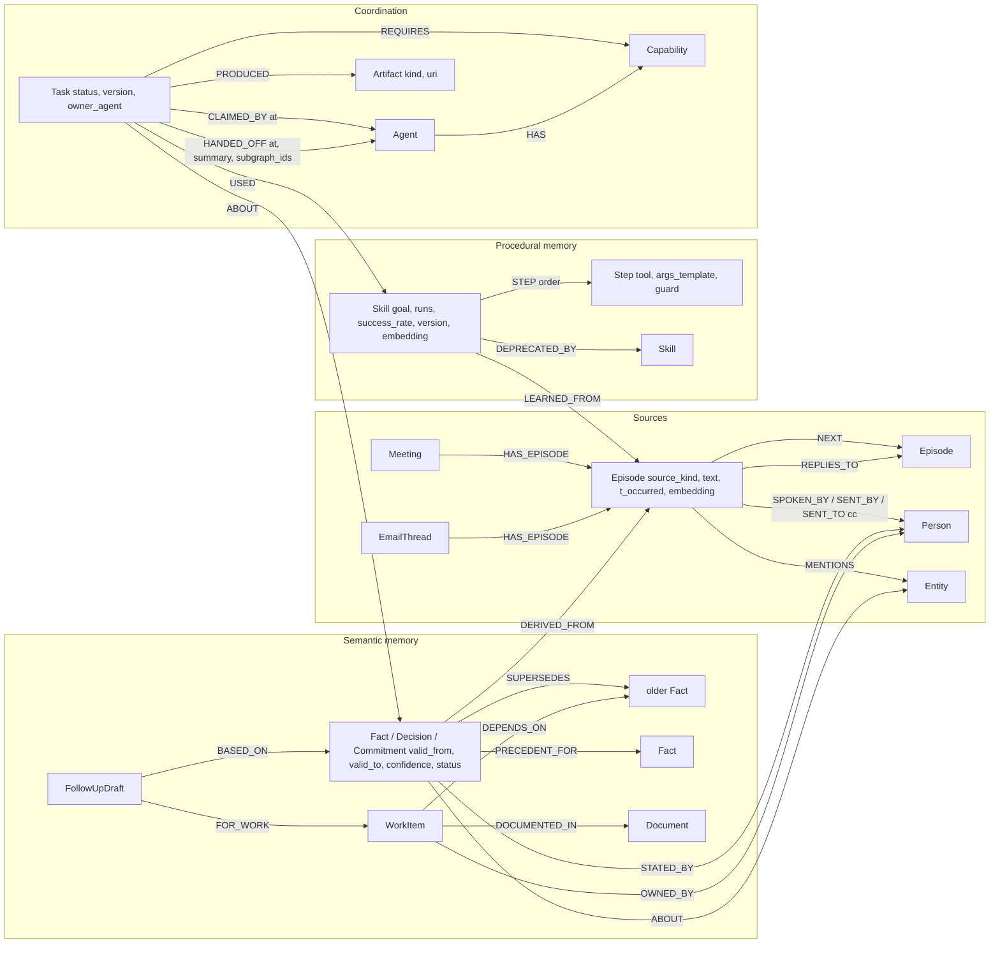

# Minutes

A Company Brain that remembers **who owns the work, why decisions changed, and what the team knew at the time**. Minutes connects meeting transcripts and email threads to people, decisions and commitments in FalkorDB. A changed deadline can trigger an agent handoff and an evidence-linked follow-up.

Target: **Track 3 — Company Brain**, Graph Hacks: Context for AI Agents (Oct 15–18, 2026). Multi-agent memory supports that use case.

**Status (Oct 9): local prototype, pre-event work.** The [event rules](https://www.wemakedevs.org/hackathons/falkordb/rules) require main coding/design to begin after the event starts. Confirm permitted reuse with organizers before submitting; this repository and audit must not be presented as work begun on Oct 15.

**Live demo:** https://minutes-falkordb.vercel.app

Read the [visual design notes](docs/frontend-design.md), [decision-impact contract](docs/decision-impact.md), [audit and Track 3 assessment](docs/track3-readiness.md) and the [three-minute demo](docs/demo-script.md). Local graph behavior is verified; real-model extraction quality and production access control remain gaps.

## Team Vulcan

| Member | GitHub |
|---|---|
| Pallab Das | [@PDGamerSG](https://github.com/PDGamerSG) |
| Yuvraj Singh | [@Yuvraj-025](https://github.com/Yuvraj-025) |
| Rudra Pratap | [@rpratap2111](https://github.com/rpratap2111) |
| Aditya Arnav | [@Hydra-Of-Malice](https://github.com/Hydra-Of-Malice) |

## What it does

- **Episodic memory**: every utterance and every email becomes an `Episode` with a speaker or sender, a timestamp and an embedding, chained in order.
- **Semantic memory**: facts, decisions and commitments are extracted by the configured model (or replayed from gold labels in demo mode), validated, and stored bi-temporally (`valid_from`, `valid_to`). When a date moves or a vendor changes, the old fact is expired and linked with `SUPERSEDES`, even when the change came from a different source (a meeting commitment moved by an email).
- **Procedural memory**: recurring routines (the standup) are learned as `Skill` nodes with ordered `Step`s and a success rate that updates every time an agent runs them.
- **Coordination**: agents claim tasks with a compare-and-set Cypher query, hand off through `HANDED_OFF` edges that carry subgraph ids, and wake each other over Redis pub/sub on the same server. Task states follow A2A (submitted, working, input_required, completed, failed).
- **Tenancy**: one FalkorDB graph per team plus a shared `commons` graph, with per-graph database ACL users. The HTTP API does not yet authenticate users or authorize tenant membership. Remove FalkorDB and nothing works: memory, tasks, skills, tenancy and answers all live in the graph.
- **Decision impact**: a versioned delivery document explicitly links work to a decision and an owner. On a reversal, the overview identifies open work that needs review, preserves aligned/closed work, and saves an evidence-linked follow-up draft in FalkorDB. Nothing is sent externally.
- **Explainability**: the Why panel shows the Cypher that ran, the subgraph it touched, the router decision, and a "play at timestamp" or "open email" link for every source.

## Repository

```
cypher/              every query the product depends on, numbered, single source of truth
packages/hiveboard/  the substrate: schema, tenancy, memory, board, skills, events, UDF, MCP server, bench
packages/ingest/     recorder and email formats, chunking, EmbeddingGemma, Gemma 4 extraction, eval
apps/api/            FastAPI: routes, agents (fact, follow-up, scheduler, standup, answer), SSE
apps/web/            Next.js: sources, chat with Why panel, board, timeline, skills, bench
data/                scripted meetings and email threads (synthetic, our own), gold labels, seed
docs/                research, plan, contracts, demo script, benchmark results
```

## Run locally

Prerequisites: Docker, Python 3.12 or 3.13, `uv`, Node.js 20+, and pnpm. Run this deterministic demonstration against **real FalkorDB**, with scripted agents and test embeddings:

```bash
cp .env.example .env                  # on first setup only
export LLM_BACKEND=fake EMBED_BACKEND=fake
docker compose up -d falkordb         # image 6.0.1; DB 6379, browser 3000
uv sync --all-packages
uv run --package minutes-api python data/seed.py --tenants orbit,nimbus,quill --extract gold
uv run --package minutes-api python data/seed_work.py --tenants orbit
uv run --package minutes-api uvicorn apps.api.main:app --port 8080
```

In a second terminal:

```bash
cd apps/web
pnpm install --frozen-lockfile
pnpm dev                             # http://localhost:3001
```

The work manifest references the exact reviewed gold facts. Import it after gold seeding; do not use these IDs as inferred links for live-model extraction. The Orbit fixture produces 5 tracked items: 3 need review, 1 is aligned, and 1 is closed.

The web client defaults to API port 8080. On macOS with Colima, use your active Docker context (`docker --context colima compose ...` if needed). `--reset` deletes the selected tenant data; use it only for a disposable demo.

`--extract gold` is the seed default and is **label replay, not live extraction**. With `LLM_BACKEND=fake`, agents follow scripted policies and answers use graph evidence templates. `EMBED_BACKEND=fake` is a deterministic test vectorizer. The shell labels both modes. Frontend-only fixtures require `NEXT_PUBLIC_MOCK=1`; connection failures do not switch to them.

For live models, configure one supported provider in `.env`: Ollama (`LLM_BACKEND=ollama`), Gemini (`gemini` plus `GEMINI_API_KEY`) or OpenRouter (`openrouter` plus `OPENROUTER_API_KEY`). Verify your selected model ID and availability. Use `EMBED_BACKEND=onnx` with the configured EmbeddingGemma model, or `gemini` with a compatible `EMBED_MODEL` and key. API startup fails when a requested embedding backend cannot load. Keep the same embedding backend/model when seeding and querying; changing it requires rebuilding embeddings in a disposable or migrated graph.

Live extraction must be selected explicitly with `data/seed.py --extract real`. The existing [extraction evaluation](docs/eval/extraction.md) reports precision **0.42**, recall **0.59**, F1 **0.49**; the audit did not rerun a real model. Keep live experiments separate from the demonstration data.

Verify:

```bash
FALKORDB_URL=falkor://localhost:6379 uv run --all-packages pytest -q
cd apps/web
pnpm typecheck
pnpm lint
pnpm build
```

## Graph data model

One FalkorDB graph per team (`team_<slug>`) plus a shared `commons` graph (tenant registry, snapshot metadata, published skills). All timestamps are epoch milliseconds. Every node with an `id` has a unique constraint.



| Label | Key properties | Role |
|---|---|---|
| Person | id, name, role, email | speakers and email senders; the roster joins the two sources |
| Meeting, EmailThread | id, title or subject, started_at | episode containers |
| Episode | id, seq, source_kind (utterance, email), text, t_start, t_end, t_occurred, t_ingested, embedding | episodic memory, chained by NEXT |
| Entity | id, name, type, embedding | what episodes and facts are about; CO_MENTIONED edges feed WCC |
| Fact (+Decision, +Commitment label) | id, key (subject plus predicate), object, text, confidence, valid_from, valid_to, created_at, expired_at, status, due_at | semantic memory, bi-temporal; status active, superseded or retracted |
| WorkItem, Document, FollowUpDraft | work id/status/rationale; versioned document content; persisted draft payload | explicit decision dependencies and local follow-up evidence |
| Task | id, kind, status (submitted, working, input_required, completed, failed), version, owner_agent, priority, payload | blackboard; version is the compare-and-set token |
| Agent, Capability | id, name, model; name | who can claim what |
| Skill, Step, FailureMode | id, goal, runs, success_rate, version, status, embedding; order, tool, args_template, guard | procedural memory with outcome statistics |
| Artifact | id, kind (github_issue, nudge, standup_summary), uri, text, simulated | what agents produced |
| Snapshot, Tenant (in commons) | id, tenant, graph_name, taken_at; slug, display_name, users | GRAPH.COPY snapshots and the tenant registry |

Indexes per tenant graph: range indexes on ids, timestamps and status; full-text on Episode, Fact and Decision text; HNSW vector indexes (768-d cosine, EmbeddingGemma) on Episode, Fact, Skill and Entity. See `cypher/00_schema.cypher`.

Database isolation is enforced for the tenant Redis ACL users. The current API uses an administrative connection and accepts tenant slugs without user authentication; these ACL tests do not establish HTTP authorization. On FalkorDB 6.0.1 (and 4.22.0) the read-only key selector `%R~graph` that the docs show for read-only users rejects even `GRAPH.RO_QUERY`, because both graph commands declare their key with read-write flags (`%RW~` and `~` work). Minutes therefore enforces read-only access at the command level and isolation with key patterns:

```
ACL SETUSER team_<slug>_rw reset on ><pw> +INFO +PING +CLIENT|SETINFO +GRAPH.RO_QUERY +GRAPH.EXPLAIN +GRAPH.QUERY +GRAPH.PROFILE ~team_<slug> ~commons
ACL SETUSER team_<slug>_ro reset on ><pw> +INFO +PING +CLIENT|SETINFO +GRAPH.RO_QUERY +GRAPH.EXPLAIN ~team_<slug> ~commons
```

API startup restores missing runtime ACL users after a Redis restart, validates the read-only connection, and preserves existing credentials/policies (including disabled users). Startup failure prevents workers from starting.

The read-only user cannot run `GRAPH.QUERY`, `GRAPH.RO_QUERY` rejects write clauses, and neither user can touch another tenant's graph (tested).

## Cypher

Every query the product depends on lives in `cypher/` and is loaded by name from Python (`hiveboard.queries`), so the folder is the single source of truth. Values are always parameters, never string-formatted.

- `00_schema.cypher`: indexes (range, full-text, vector); constraints are applied by `hiveboard.schema`
- `01` to `05`: upsert Person, Meeting, EmailThread, Entity; link MENTIONS and CO_MENTIONED
- `10_ingest_episode`: episodes under a Meeting or EmailThread with SPOKEN_BY / SENT_BY / SENT_TO / REPLIES_TO / NEXT
- `11_ingest_fact`: Fact (plus Decision or Commitment label) with DERIVED_FROM, ABOUT, STATED_BY
- `12_supersede_fact`: expire the active fact with the same key and link SUPERSEDES (bi-temporal)
- `13` to `17`: retract, active facts, full-text lookup, last episode, fact status
- `20_claim_task`: compare-and-set claim; zero rows means another agent won
- `21_handoff_task`: hand a task to another agent with a subgraph reference
- `22` to `29`: complete, trace, set state, register agent, submit, next open task, list tasks, list agents
- `30_recall_hybrid`: vector KNN, one-hop expansion through shared entities, policy score via the `hive.score` UDF
- `31_belief_at_time`: what was true at valid time T, optionally as known by time K
- `32_why_path`: provenance for a fact: episode, speaker or sender, container, supersession chain
- `40` to `46`: skill retrieve (KNN plus success rate), outcome (running mean), learn, deprecate, export, publish to commons, list
- `50_who_knows`: people who talked or wrote about an entity (SPOKEN_BY, SENT_BY, SENT_TO)
- `51` to `53`: open commitments, contradictions between active facts, stale decisions
- `60_pagerank_skills`: `algo.pageRank` over Task-USED-Skill
- `61_wcc_entities`: `algo.WCC` over CO_MENTIONED entities
- `70` to `74`: snapshot metadata and tenant registry in `commons`
- `80` to `83`: atomic dependency import, impact traversal, version-checked local draft creation, draft history

The retrieval policy is a JavaScript UDF stored in the database (`packages/hiveboard/hiveboard/udf/score.js`, loaded with `GRAPH.UDF LOAD REPLACE hive`): `hive.score(valid_from, confidence, distance, now)` = recency (exp of minus age in days over 30) times importance (confidence) times similarity (1 minus cosine distance).

## Benchmarks

These are recorded prior runs from the repository, not new measurements from the Oct 9 audit. No hosted performance claim is made. Harness: `packages/hiveboard/bench/harness.py`. N simulated agents across M tenant graphs, 80 percent reads (hybrid recall, active facts, task listing) and 20 percent writes (facts with supersession, claims, completions), plus a compare-and-set race on one task per tenant. `--procs` splits the client across processes so Python's GIL does not cap the load. Full method, machine and interpretation: [`docs/bench/README.md`](docs/bench/README.md); raw JSON in `docs/bench/`.

Machine: one laptop (i9-13900HX, 48 GB RAM, Docker Desktop on WSL2), client and server on the same host, FalkorDB image defaults (THREAD_COUNT 32). These are not server-capacity numbers.

| Engine | Agents x tenants | Client procs | Duration | Read p50 / p95 / p99 (ms) | Write p50 / p95 / p99 (ms) | Ops/s | Errors | CAS winners / attempts |
|---|---|---|---|---|---|---|---|---|
| 4.22.0 | 20 x 4 | 4 | 60 s | 11.0 / 29.0 / 36.9 | 15.1 / 51.1 / 67.7 | 1,379 | 0 | 4 / 100 |
| 6.0.1 | 20 x 4 | 4 | 60 s | 8.5 / 20.3 / 25.2 | 11.9 / 39.4 / 51.6 | 1,794 | 0 | 4 / 100 |
| 4.22.0 | 100 x 1 | 4 | 60 s | 21.4 / 52.7 / 73.9 | 321.9 / 767.8 / 871.5 | 1,092 | 0 | 1 / 25 |
| 6.0.1 | 100 x 1 | 4 | 60 s | 7.1 / 28.1 / 50.3 | 272.3 / 640.2 / 743.6 | 1,560 | 0 | 1 / 25 |
| 6.0.1 (MAX_QUEUED_QUERIES 1000) | 200 x 20 | 8 | 120 s | 52.0 / 135.1 / 168.2 | 88.6 / 262.8 / 329.3 | 2,608 | 0 | 20 / 500 |

What the numbers say:
- With the load spread over 4 tenant graphs, 6.0.1 does about 30 percent more operations per second than 4.22.0 at lower latency (repeat runs within 1 percent).
- Putting 100 agents on one graph shows per-graph write serialization on both engines: write p50 rises from about 12 ms to 260 to 360 ms while reads stay fast. Graph-per-tenant is what keeps writes cheap.
- At 200 agents over 20 graphs, every compare-and-set race had exactly one winner. With the image default MAX_QUEUED_QUERIES of 25, 18 percent of requests were rejected with "Max pending queries exceeded"; raising it to 1000 removed every error. Our compose file sets 500.
- With a single client process the two engines tie, because the Python client, not FalkorDB, is the bottleneck.

Single-request latencies on 6.0.1: recall 4 ms, why 1 ms, claim 2 ms, remember plus supersede 3.5 ms. Returning whole nodes that carry 768-float embeddings cost about 0.5 ms per node on the wire, so every user-facing read projects nodes without the embedding.

FalkorDB findings from this work, drafted as issues in [`docs/falkordb-issues.md`](docs/falkordb-issues.md): `GRAPH.MEMORY USAGE` truncates to whole MB and never counts index memory; the `%R~` ACL selector rejects `GRAPH.RO_QUERY`; and on 6.0.1 only, `MATCH ... WHERE ...` followed directly by another `MATCH` drops the first filter (4.22.0 is correct). Every query in `cypher/` avoids that shape.

## Deployment

Live demo: **https://minutes-falkordb.vercel.app** (API: https://52-65-45-159.sslip.io/health).

- Web: Vercel, built from `apps/web` on every push to `main`.
- API and FalkorDB 6.0.1: one AWS Lightsail instance (Sydney, 1 GB) running [`infra/aws/docker-compose.yml`](infra/aws/docker-compose.yml). FalkorDB stays on the private Compose network with an append-only file on a named volume; Caddy terminates HTTPS; daily instance snapshots are enabled.
- Mode: synthetic data only, gold-label replay, scripted agents (`LLM_BACKEND=fake`) and test embeddings (`EMBED_BACKEND=fake`); the shell labels both. Demo and tenant routes are open (no `ADMIN_TOKEN`), so anyone can run the demo actions.

Set up the same host from scratch with `sudo bash infra/aws/setup.sh <hostname> <web-origin>`. See [deployment notes](infra/README.md), including the access-control work required before using private company data.

## AI assistance disclosure

AI coding assistants were used for parts of the implementation, tests, research, audits and documentation, under the team's direction. Team members must review this work, explain the implementation, and disclose assistance and permitted pre-event reuse accurately in the submission.

## License

MIT.
