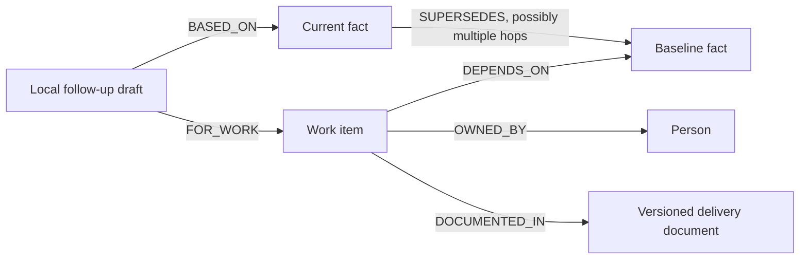

# Explicit decision impact

Minutes answers a focused Company Brain question: **which open work is still based on a decision that changed, and who should review it?**

The delivery manifest asserts the dependency. FalkorDB supplies the actual supersession chain, the recorded owner, the document version, and the fact evidence. Co-mention, similarity and LLM guesses never create this dependency.



## Reproduce the demo

Follow the README to seed meetings/emails with `--extract gold`, then run:

```bash
LLM_BACKEND=fake EMBED_BACKEND=fake uv run --package minutes-api python data/seed_work.py --tenants orbit
```

Use `FALKORDB_URL` for a nondefault port (the audited local DB uses 6389). Open `/t/orbit`. The synthetic [delivery register](../data/work-items/orbit.json) produces:

| Work | Owner | Assessment | Evidence |
|---|---|---|---|
| Payment integration runbook | Priya | Needs review | Razorpay → PayU |
| Navigation accessibility tests | Sana | Needs review | Bottom tab bar → side drawer |
| UPI release handoff document | Rahul | Needs review | Sep 24 → Sep 28 |
| October release checklist | Aditya | Aligned | Oct 16 remains unchanged |
| Original vendor sandbox spike | Priya | Closed | Completed work is not drafted |

The UPI flow itself is complete. The separate open handoff document needs review; its authored rationale says to account for the completion. This is not an overdue-task recommendation.

Expand a work item, inspect both decisions and the dependency document, then prepare a follow-up. Reload: the same draft remains. The action sends no email, issue or message and schedules no external worker.

## Connect and review work in the UI

Use **Connect work** in the overview to enter a title, choose an accountable person from this tenant's roster, select the fact version used to plan the work, and explain the dependency. Search includes earlier versions: choosing Razorpay after the PayU decision has been recorded demonstrates an outstanding review. Mark rehearsal work as synthetic.

Saving creates an explicit `DEPENDS_ON` link and a versioned dependency note through the same manifest import endpoint. The note records the selected person and fact IDs; it does not infer ownership from the speaker. The overview refreshes to show the graph's assessment. Expand **Recorded graph relationships** for the actual nodes and edges, or **How FalkorDB found the impact** for the executed Cypher.

Use the row's pencil button to change the owner, status, explanation, or baseline. After reviewing the underlying work, **Use current decision: PayU** adopts that version as its baseline. Save to move the item to **Aligned**. This records the review in Minutes; it does not edit an external runbook. Completing or cancelling the work moves it to **Closed**. Prior dependency documents and follow-up drafts remain stored, while only a draft matching the current dependency version appears on the item.

The form preserves entries on a failed save and retains the new work ID for retries. Forced frontend fixture mode blocks these writes; use the API-backed workspace for the interactive demo. Concurrent edits use the existing import's last-write-wins behavior.

## API

`GET /tenants/{tenant}/people` returns the selected tenant's recorded people (`id`, `name`, optional `email` and `role`), sorted by name and ID. An unknown tenant returns 404.

`POST /tenants/{tenant}/work-items/import` accepts:

```json
{
  "document": {
    "title": "Delivery register",
    "uri": "synthetic://orbit/delivery-register",
    "content": "The runbook depends on the recorded gateway choice.",
    "synthetic": true
  },
  "items": [{
    "id": "work_payment_runbook",
    "title": "Review the payment runbook",
    "status": "open",
    "owner_id": "spk_priya",
    "baseline_fact_id": "fact_ep_mtg_orbit_001_017_00",
    "rationale": "The runbook includes vendor-specific API instructions."
  }]
}
```

Only use IDs actually present in the selected tenant. A manifest holds 1–200 distinct work IDs; all referenced people/facts are checked before any mutation. Reimport replaces an item's dependency, owner and document links atomically. The document ID hashes the full submitted manifest, so changing the work or document produces a new version. The import is an upsert, not a deletion of other items.

`GET /tenants/{tenant}/impact` returns `summary`, `items` and the executed `cypher`. Each item includes the original/current fact with source, owner, assessment/reason, dependency document, graph nodes/edges and a matching current draft if present.

Assessments:

- `needs_review`: open work, one active fact, actual supersession path and changed value.
- `aligned`: open work still matches the current decision, including a changed version with the same value.
- `closed`: completed/cancelled work; no draft action.
- `unresolved`: missing, conflicting, retracted or unrelated evidence cannot establish one current decision/owner.

`POST /tenants/{tenant}/impact/{work_id}/draft` with `{"current_fact_id":"..."}` saves a deterministic local draft. The atomic write rechecks the owner, document, baseline, status, current version, unique active candidate and actual supersession path. A stale/nonreviewable request returns 409. Missing work returns 404. Repeat creation returns the original ID/timestamp. Historical drafts stay in `GET /tenants/{tenant}/impact/drafts`; only a draft matching the current dependency version is attached to the current report.

## Limits

This prototype supports one explicitly authored decision dependency per work item. The report and draft history are bounded to 200 results, and supersession traversal to 24 hops; it is not an exhaustive enterprise inventory at larger scale. The editor searches the API's first 500 facts and also retains an existing item's baseline/current versions when they fall outside that window. A missing imported dependency is not evidence that no work is affected. The fixture relies on reviewed gold fact IDs, not arbitrary live-extraction IDs. It is not a production ticket/document connector. HTTP authentication and live extraction quality remain separate gaps.
